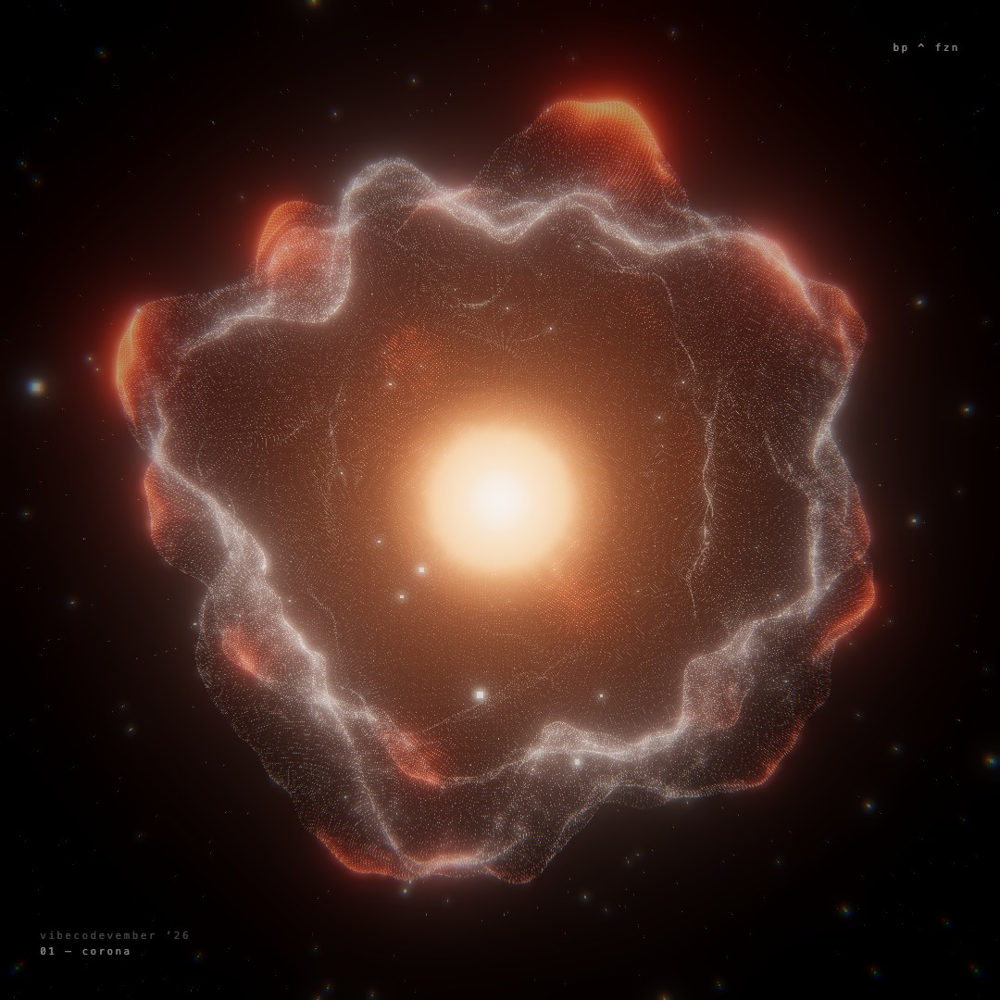

# vibecodevember ’26

Daily generative pieces made with [three.js](https://threejs.org) for November 2026, by **bp ^ fzn**.

All the entries share one stage and one mood: a near-black background, bone-white ink, a single ember accent, and the same lighting, bloom, film grain, vignette, camera drift and typography. Each day only adds its own scene on top, so most entries are a few dozen lines of code.

Every entry builds to **one self-contained HTML file**, with three.js, shaders, CSS and code all inline. Each file opens from disk with a double-click and works offline. Every entry also gets a frame-exact, seamlessly looping video.

## Entries

| | Day | Interaction |
|---|---|---|
| [](docs/videos/01.mp4) | **01 — corona**<br>A star breathing: 200k particles on a noise-warped shell, lit from within. | none |
| [](docs/videos/02.mp4) | **02 — aftershock**<br>A disc of steel rods heated by crossing shockwaves, from ember to white. | move: heat the rods · click: strike a shockwave |
| [](docs/videos/03.mp4) | **03 — filament**<br>3,000 silk fibres braided round a morphing knot, with sparks, embers and plucked vibrations. | move: comb · click: pluck · hold: unravel |

Click a thumbnail for its video. To see an entry live, open `docs/NN.html` in a browser after cloning or downloading the repository; `docs/index.html` is a gallery of all entries.

The `docs/` folder is the published site. GitHub Pages serves it directly: in the repository's **Settings → Pages**, choose **Deploy from a branch**, then the `main` branch and the `/docs` folder. Any other static host works too.

## Getting started

Requirements:
- [Node.js](https://nodejs.org). The project was developed on Node 26; recent versions should work.
- [Google Chrome](https://www.google.com/chrome/), only for recording videos. The recorder drives the installed Chrome headless. ffmpeg is bundled through `ffmpeg-static`, so it doesn't need to be installed.

```sh
npm install
npm run new            # scaffold today's entry as days/NN.js and build it (or: npm run new -- 12)
npm run dev            # rebuild on every save; open docs/NN.html and refresh
npm run build          # build every entry to docs/NN.html, plus docs/index.html
npm run publish        # build, then record today's video → docs/videos/NN.mp4 + NN.jpg poster
npm run publish -- 3 7 --size 1080x1920 --fps 60 --seconds 20 --crf 22
```

Without a day number, `new` and `publish` use today's date.

## Writing an entry

An entry is one file, `days/NN.js`:

```js
import { go, THREE, C, U, R, TAU, noise, pointer } from '../lib/stage.js'

go('title', ({ scene, camera, renderer }) => {
  const mesh = new THREE.Mesh(new THREE.IcosahedronGeometry(1.4, 0), new THREE.MeshStandardMaterial({ color: C.ink, metalness: 1, roughness: 0.15 }))
  scene.add(mesh)
  return (t, p) => mesh.rotation.set(p * TAU, p * TAU * 2, 0) // t: seconds · p: 0→1 over one loop
}, { loop: 10, eye: [0, 0, 10], drift: 1, bloom: 0.9, fog: 0.045 })
```

`go(title, setup, options)` creates the shared stage, calls `setup` once, then calls the function it returns on every frame. The title appears in the label and the page title.

| Option | Default | Meaning |
|---|---|---|
| `loop` | `10` | Loop length in seconds; also the default video length |
| `eye` | `[0, 0, 10]` | Camera position; the camera always looks at the origin |
| `drift` | `1` | Strength of the slow camera drift and mouse parallax (`0` turns it off) |
| `bloom` | `0.9` | Bloom strength |
| `fog` | `0.045` | Exponential fog density |

| Export | What it is |
|---|---|
| `THREE` | three.js |
| `C` | Palette as hex values: `bg`, `ink`, `accent` |
| `U` | Shared shader uniforms: `time`, `phase`, `res`, `ink`, `accent`. Pass them as `uniforms: U`, or spread them into your own: `{ ...U, mine: { value: 0 } }` |
| `R` | Seeded random: `R()` gives [0,1), `R(a)` gives [0,a), `R(a, b)` gives [a,b) |
| `noise` | GLSL 3D simplex noise, `snoise(vec3)`; prepend it to a shader string |
| `TAU` | 2π |
| `pointer` | The mouse in normalized device coordinates, for `raycaster.setFromCamera(pointer, camera)`. `pointer.active` turns true once the mouse moves; it never does while recording |

### Rules for perfect loops

- **Animate with the phase**: `p` in JavaScript, `phase` in GLSL. Use only whole cycles per loop, such as `sin(p * TAU * n)` or a circle through noise space. The default video is exactly one loop long, so it repeats without a seam.
- **Use `R`, never `Math.random`, `Date` or `performance.now`**, so every render, live or recorded, is identical.
- **Keep interaction additive.** Mouse effects only apply when `pointer.active` is true, so recordings are unaffected.

## How it works

### Build

`scripts/build.mjs` turns each `days/NN.js` into a standalone `docs/NN.html`:

1. **esbuild** bundles the entry with the shared stage and only the parts of three.js it uses.
2. **Terser** minifies it with safe settings. Its `unsafe` options break three.js.
3. The result is deflated at maximum compression and inlined as base64. The browser's built-in `DecompressionStream` unpacks it in about 50 ms.

That takes an entry from about 760 KB to about 250 KB.

`npm run build -- --roadroller` packs with [Roadroller](https://github.com/lifthrasiir/roadroller) instead. That gets an entry down to about 175 KB, but unpacking takes several seconds on every page load and packing takes about 25 s per entry. It's best kept for size-limited submissions. `npm run dev` skips packing entirely, so rebuilds stay instant.

### Recording

`scripts/record.mjs` opens `docs/NN.html?record` in headless Chrome. In record mode the page doesn't animate in real time. Instead, it exposes `window.__frame(t)`, and the recorder renders each frame at an exact time step, so heavy scenes never drop frames. It captures every frame and pipes it to ffmpeg (H.264, `yuv420p`, `+faststart`). It also saves a poster from the middle frame.

Recording options:

| Option | Default | Meaning |
|---|---|---|
| `--size` | `1080x1080` | Output size, for example `1080x1920` for vertical video |
| `--fps` | `60` | Frame rate |
| `--seconds` | one loop | Duration |
| `--crf` | `22` | x264 quality. Higher values give smaller files; detailed scenes with grain compress poorly, so 26–28 suits web copies |

Recording has been tested on macOS. The browser flags request Metal for GPU rendering; on other platforms Chrome should fall back to its default backend.

## Project layout

```
days/       one file per entry (NN.js)
lib/        shared stage: renderer, post-processing, palette, noise, label styles
scripts/    build, record and scaffold scripts
docs/       generated output, published by GitHub Pages: NN.html, index.html, videos/
```

`docs/` is generated, so make changes in `days/`, `lib/` or `scripts/` and rebuild.

## License

[Apache License 2.0](LICENSE)
